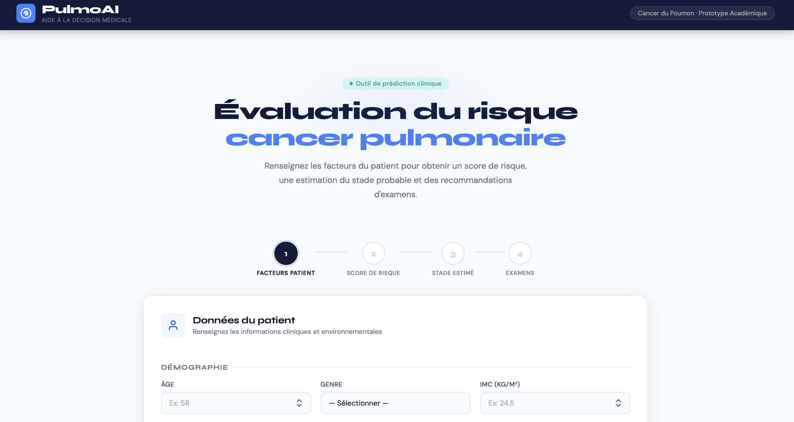
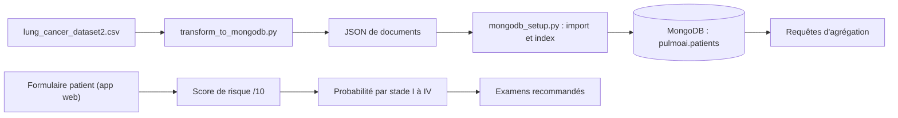

# PulmoAI : scoring et aide à la décision pour le cancer du poumon

Projet **NoSQL** en deux volets : une base **MongoDB** construite à partir d'un jeu de données de 1 500 patients et interrogée avec des requêtes d'agrégation, et une **application web** qui transforme un formulaire patient en score de risque, estimation de probabilité par stade et recommandations d'examens.

**Stack :** MongoDB · Python (pandas, pymongo) · JavaScript, HTML, CSS

> Démo interactive de l'application : 



> Prototype académique, non destiné à un usage clinique.

## Contenu du projet



| Volet | Rôle |
|---|---|
| **Base de données** | Transformation du CSV en documents imbriqués, import dans MongoDB, 11 index, requêtes d'analyse (survie par stade, traitements, symptômes...) |
| **Application web** | Fichier HTML autonome : le calcul se fait dans le navigateur, sans connexion à la base |

## Modèle de données

Chaque patient devient un document structuré (les 10 symptômes Yes/No sont regroupés en un tableau, les Yes/No deviennent des booléens) :

```json
{
  "_id": "LC-0034",
  "age": 62,
  "gender": "Male",
  "location": { "country": "Vietnam" },
  "smoking": { "status": "Current Smoker", "cigarettes_per_day": 39, "years_smoking": 30 },
  "lifestyle": { "bmi": 23.5, "alcohol_use": "Moderate", "exercise_frequency": "Low" },
  "risk_factors": {
    "secondhand_smoke": false, "family_history": true, "occupational_hazard": false,
    "air_pollution_exposure": "Low", "asbestos_exposure": false, "radon_exposure": false
  },
  "symptoms": ["Coughing", "Shortness of Breath", "Coughing Blood", "Recurrent Infections", "Finger Clubbing"],
  "clinical": { "stage": "Stage II", "previous_cancer_history": true, "diagnosis_method": "PET Scan" },
  "outcome": { "treatment": "Chemotherapy", "survival_months": 43, "survived": true }
}
```

Le script `mongodb_setup.py` crée 11 index : stade, survie, tabagisme, antécédents familiaux, pays, âge, genre, symptômes (index multikey), traitement, durée de survie, et un index composé stade + pays.

## Requêtes d'exemple

Le fichier [`queries/queries.js`](queries/queries.js) contient les requêtes, par exemple le taux de survie par stade :

```js
db.patients.aggregate([
  { $group: { _id: "$clinical.stage", total: { $sum: 1 },
              survived: { $sum: { $cond: ["$outcome.survived", 1, 0] } } } },
  { $addFields: { survival_rate_pct: { $multiply: [{ $divide: ["$survived", "$total"] }, 100] } } },
  { $sort: { _id: 1 } }
])
```

## Application web

Le formulaire collecte l'âge, le genre, l'IMC, le tabagisme, le mode de vie, les expositions (pollution, amiante, radon, fumée passive, risque professionnel), les antécédents et 10 symptômes. L'application déroule 4 étapes :

1. **Facteurs patient** : saisie du dossier.
2. **Score de risque sur 10** : somme pondérée des facteurs (tabagisme jusqu'à 3,5 points, âge, environnement, antécédents, symptômes, mode de vie), avec détail de chaque contribution. Niveaux : faible (≤ 3), modéré (≤ 6), élevé (> 6).
3. **Stade probable** : probabilités pour les stades I à IV, calculées à partir du score et des symptômes critiques.
4. **Examens recommandés** : par exemple scanner thoracique faible dose, bilan biologique, bronchoscopie en cas de toux avec sang, TEP-scanner et biopsie pour les stades avancés, spirométrie.

## Lancer le projet

**Prérequis :** Python 3.9+, et MongoDB (en local ou avec Docker).

```bash
git clone https://github.com/Chaki0107/pulmoai-lung-cancer-risk.git
cd pulmoai-lung-cancer-risk
pip install -r requirements.txt
```

1. **Démarrer MongoDB** (avec Docker) :
   ```bash
   docker run -d --name pulmoai-mongo -p 27017:27017 mongo:7
   ```
   Si MongoDB tourne sur une autre adresse ou un autre port, définis la variable d'environnement `MONGO_URI` avant l'étape 3 (par exemple `mongodb://localhost:27024`).
2. **Transformer le CSV en documents** :
   ```bash
   python scripts/transform_to_mongodb.py
   ```
3. **Importer dans MongoDB et créer les index** :
   ```bash
   python scripts/mongodb_setup.py
   ```
   Le script affiche le nombre de documents, la répartition par stade et le taux de survie.
4. **Exécuter les requêtes** (avec `mongosh` installé) :
   ```bash
   mongosh "mongodb://localhost:27017" --file queries/queries.js
   ```
5. **Ouvrir l'application** : ouvre `app/index.html` dans ton navigateur.

## Données

Le dépôt contient un **échantillon de 150 patients** (`data/lung_cancer_sample.csv`, tiré de façon équilibrée entre les 4 stades) d'un jeu de données de 1 500 patients et 32 colonnes : démographie, tabagisme, mode de vie, expositions, symptômes, stade, méthode de diagnostic, traitement et survie. Source et licence : **[à préciser : lien du jeu de données et licence]**.

Pour utiliser le jeu complet, place-le dans `data/` et modifie `INPUT_FILE` dans `scripts/transform_to_mongodb.py`.

## Limites et pistes d'amélioration

- **L'application web est indépendante de la base** : les pondérations du score et les probabilités par stade sont des règles définies à la main, pas un modèle entraîné sur les données.
- Piste principale : entraîner un modèle (régression logistique, Random Forest) sur le jeu de données pour calibrer le score, et mesurer ses performances.
- Connecter l'application à MongoDB via une petite API (Flask ou FastAPI) pour afficher des statistiques de survie dans les résultats.

## Auteure

**Chahnez Naccache** · Master Data Science · [LinkedIn](https://linkedin.com/in/chahnez-naccache) · [Portfolio](https://github.com/Chaki0107/Portfolio)
